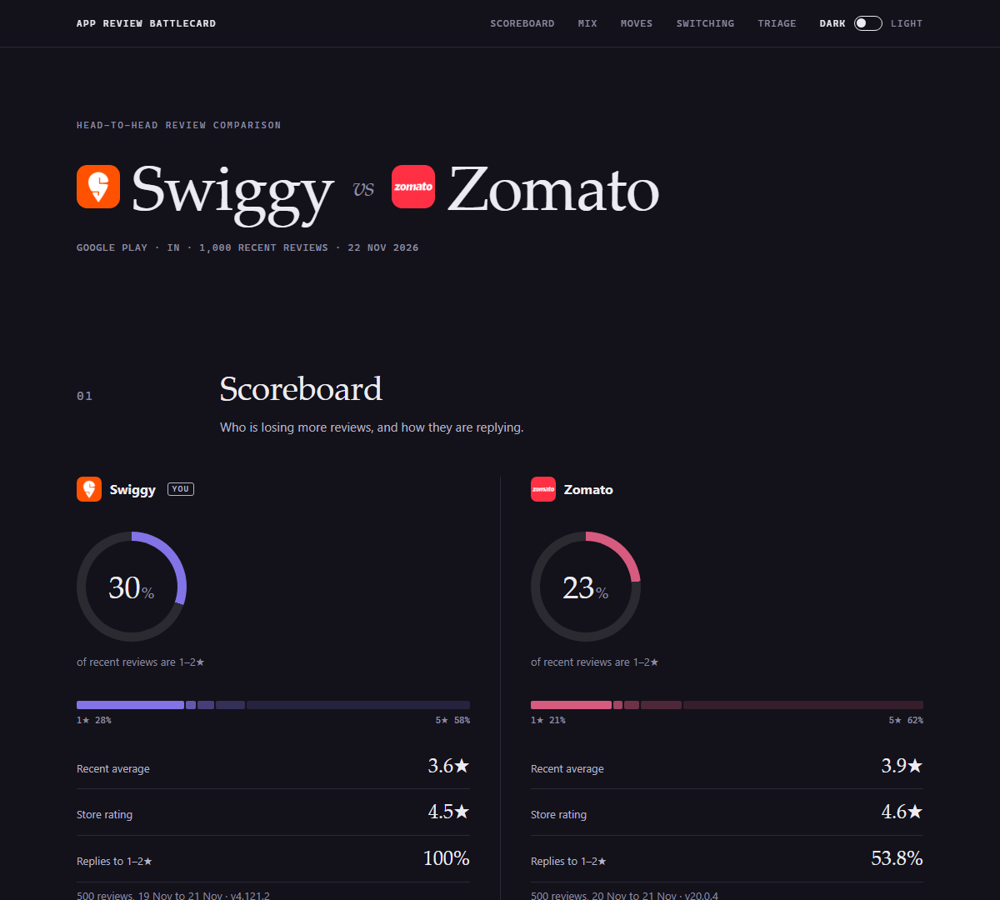
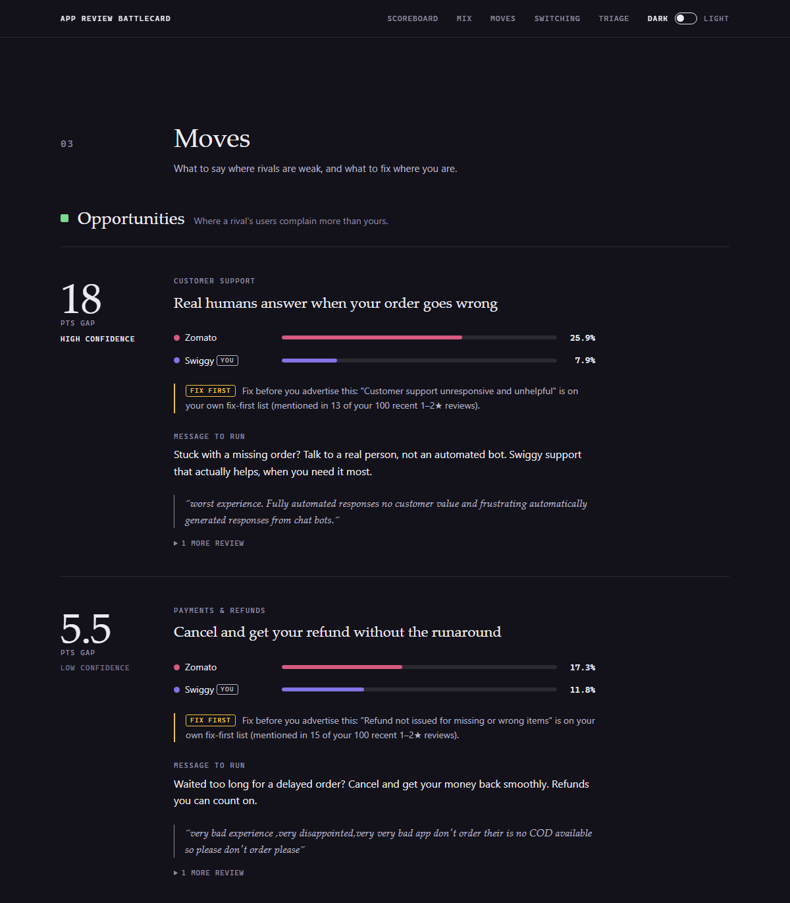
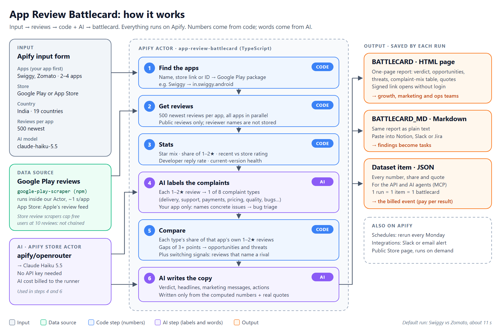

# App Review Battlecard: Your App vs Rivals

**Where are your rivals' users angry this week, and where are yours?** Give it your app and 1 to 3 rivals. It reads the latest Google Play reviews, sorts every 1–2★ review into a complaint theme, and hands back a one-page **battlecard** in about 15 seconds.

**Try it now:** click **Start** with the default input (Swiggy vs Zomato). The battlecard is ready in about 15 seconds.



## At a glance

| | |
|---|---|
| **Buyer** | Product-marketing, growth and ops teams at consumer apps; agencies; analysts |
| **Input** | Your app + 1–3 rivals (a name is enough), store, country |
| **Output** | Verdict, 3 opportunities, 3 threats, fix-first list, complaint-mix table. HTML page + Markdown + JSON |
| **Basis of comparison** | Each theme's share of an app's *own* specific 1–2★ complaints (vague "worst app" reviews left out), not star averages |
| **How it helps you do better** | Opportunity = a rival's weak spot you can message. Threat = your weak spot, with the owner team and a first action |
| **Data** | Public Google Play reviews (App Store optional). No API key needed |
| **Pricing** | **$0.49 per battlecard** (one per run). A failed run saves no battlecard, so you don't pay the $0.49 |

## What you get

- 🟢 **Opportunities:** themes where a rival's users complain much more than yours, with a ready marketing line and real quotes.
- 🔴 **Threats:** themes where your users complain more than a rival's, with the team that owns the fix.
- 🛠 **Fix-first list:** up to 6 named issues in your app ("Refund not issued for missing items") with owner team, review count and a real quote.
- 🔁 **Switching signals:** unhappy reviews that name another app ("use Blinkit, their support is better"), counted both ways.
- ⚖️ **Verdict:** one sentence you can paste into Slack.
- 📊 **Complaint-mix table:** every theme, every app, side by side.



## Works for any app category, not just food

Type app names. The Actor finds them on Google Play and compares them the same way. The 8 complaint themes (bugs, payments, delivery/fulfilment, quality, pricing, support, UX, account) fit any consumer app.

| Category | Try this input |
|---|---|
| Food and grocery delivery (default) | `Swiggy`, `Zomato` |
| Ride-hailing | `Uber`, `Ola`, `Rapido` |
| UPI payments | `PhonePe`, `Google Pay`, `Paytm` |
| Fashion shopping | `Myntra`, `Ajio` |
| Travel booking | `MakeMyTrip`, `Goibibo` |

## Why "complaint mix", not star ratings

In-app rating prompts push happy users to rate, so averages say little. Swiggy and Zomato both show about 4.5★ on Google Play, yet a third of Swiggy's latest reviews are 1–2★. This Actor compares **what people complain about**: if 18% of Zomato's complaints are about support but only 6% of yours, that's a message you can run.

Opportunities and threats come from the numbers (gap of 3+ points and 2+ reviews). The AI only labels reviews and writes the wording.

## How accurate is it?

- **Numbers are computed in code**, not by the AI: counts, shares, gaps, reply rates, switching signals.
- **Each gap has a confidence level** (high / medium / low) from a two-proportion test. It is always low when either app has fewer than 15 specific complaints.
- **Second-pass label check:** a second AI pass re-labels a sample of reviews. In our test runs the two passes agreed on 73–90% of reviews, and 56% on a small 16-review App Store sample (the score is in `labelCheck` and in the report).
- **Vague reviews are left out** of theme shares, so an app with many "worst app" reviews doesn't create fake gaps.
- Tested on food delivery, rides, payments, shopping, a US app pair and the App Store. Results are in the [test-runs folder](https://github.com/kuheli7/app-review-battlecard/tree/main/test-runs).

## Who it's for

- **Product marketing and growth teams** at consumer apps (food delivery, quick commerce, fintech, travel) writing competitive messaging and battlecards.
- **Product and ops leads** who want to know which complaints are theirs and which are industry-wide.
- **Agencies** pitching or running campaigns for an app.
- **Analysts** tracking consumer-tech companies through customer sentiment.

## Output fields

| Field | What it is |
|---|---|
| `verdict` | One-sentence takeaway |
| `opportunities[]` | Up to 3 rival weaknesses: theme, rival, both shares, confidence, headline, marketing message, 2 real quotes. If the same theme is also on your own fix-first list, the card carries a `caution` ("fix before you advertise this") and is listed last |
| `threats[]` | Up to 3 of your weaknesses: theme, rival, both shares, confidence, headline, suggested action, owner team, 2 real quotes |
| `fixFirst[]` | Your app's top 3 issues to fix, each with review count and owner team |
| `yourIssues[]` | Up to 6 named issues for your app: title, theme, owner team, review count, share of 1–2★, count on the current version, quotes |
| `switching[]` | For each app: how many of its 1–2★ reviews name another compared app, with quotes |
| `apps[]` | Per app: reviews analysed, date range, star mix, % of 1–2★, recent vs store rating, developer reply rate to 1–2★ reviews (Google Play), latest-version health, theme shares |
| `reportUrl` | Shareable link to the one-page HTML battlecard (opens without logging in; also in the **Output** tab) |
| `classicReportUrl` | The same battlecard in a plain light layout |
| `markdownUrl` | Shareable link to the Markdown version |
| `labelCheck` | How often a second AI pass agreed with the theme labels (checked, agreed, %) |
| `skippedApps` | Apps from your input that were left out (not found, or too few reviews) |

Also saved to the run's key-value store:

- `BATTLECARD`: a formatted one-page HTML report to share with your team (dark/light switch).
- `BATTLECARD_CLASSIC`: the same report in a plain light layout.
- `BATTLECARD_MD`: the same report as Markdown, ready for Notion, Slack or a doc.

### Example output (real run, Swiggy vs Zomato, Google Play India, 22 Nov 2026, shortened)

```json
{
  "yourApp": "Swiggy",
  "rivals": ["Zomato"],
  "store": "Google Play",
  "verdict": "Swiggy's complaint mix is dominated by late or missing deliveries, a gap rivals show far less, so reliability is the lead to fix and to contrast.",
  "topOpportunity": "Real humans answer when your order goes wrong: 18% of Zomato's 1–2★ reviews are about customer support, vs 6% of yours.",
  "opportunities": [
    {
      "theme": "SUPPORT",
      "rival": "Zomato",
      "rivalShare": 18,
      "yourShare": 6,
      "headline": "Real humans answer when your order goes wrong",
      "message": "Stolen order or money lost? Swiggy support replies with people, not bots. Help you can actually reach when it matters.",
      "quotes": ["worst experience. Fully automated responses no customer value and frustrating automatically generated responses from chat bots."]
    }
  ],
  "threats": [
    {
      "theme": "FULFILMENT",
      "rival": "Zomato",
      "yourShare": 39,
      "rivalShare": 27,
      "owner": "Operations",
      "headline": "Late and missing deliveries are your top complaint",
      "action": "Launch a delivery-reliability sprint on wrong-location and rider-conduct failures, with weekly tracking; owner: Operations."
    }
  ],
  "reportUrl": "https://api.apify.com/v2/key-value-stores/<id>/records/BATTLECARD?signature=<signature>"
}
```

The same run also found that:

- Swiggy replied to **100%** of its recent 1–2★ reviews on Google Play, while Zomato replied to about **51%**.
- **8** of Swiggy's 161 recent 1–2★ reviews name Zomato; only **1** of Zomato's names Swiggy.
- Swiggy's fix-first list: unresponsive customer support (18 of 100 reviews), late deliveries (17), refunds denied or delayed (13).

## How to use it

1. Enter your app first, then 1 to 3 rivals. Use names (`Swiggy`), store URLs, Google Play package names (`in.swiggy.android`) or App Store IDs (`989540920`).
2. Pick the store and country.
3. Click **Start**. Open the **Output** tab for the battlecard.

Run it on a **schedule** (for example every Monday) and connect Slack or email in **Integrations** to get a weekly competitor report.

## Input

| Field | Default | Notes |
|---|---|---|
| `apps` | `["Swiggy", "Zomato"]` | 2 to 4 apps, yours first |
| `store` | Google Play | Or Apple App Store |
| `country` | India | Reviews are country-specific |
| `reviewsPerApp` | 500 | Most recent reviews read per app (50–500) |
| `maxNegativeReviewsForAI` | 100 | 1–2★ reviews the AI labels per app; caps cost and time |
| `model` | `anthropic/claude-haiku-5.5` | Any OpenRouter model ID |

## How it works



1. **Data:** fetches each app's details and its newest reviews from Google Play, or from Apple's public review feed.
2. **Stats in code:** star mix, share of 1–2★, recent vs store rating, developer reply rate, and latest-version vs previous-version health.
3. **AI labelling:** an LLM tags every recent 1–2★ review with one of 8 fixed themes (bugs, payments, delivery, quality, pricing, support, UX, account), each mapped to an owner team.
4. **Gaps in code:** compares each theme's share across apps. Opportunities and threats come from the numbers, not from the AI.
5. **Switching signals in code:** a plain text match finds 1–2★ reviews that name another compared app.
6. **Bug triage:** a second AI call names concrete recurring issues in your app's 1–2★ reviews and points to the reviews behind each. Counts, shares and quotes are computed in code from those reviews. If this step fails, the battlecard still ships without it.
7. **AI copy:** the AI writes the verdict, headlines and messages using only the computed numbers and the real quotes.

The AI runs through Apify's OpenRouter integration, so **you don't need an API key**. Model usage is billed to your Apify account at cost.

## Pricing

**$0.49 per battlecard.** One run gives one battlecard. The AI model usage is billed to your Apify account at cost (about $0.01 per run with the default model; higher on the free plan).

Reading and sorting 1,000 reviews by hand takes hours. A weekly battlecard for one app and 3 rivals costs about $2 a month.

## Success and failure

- **Success:** one battlecard item in the dataset, and the HTML and Markdown reports in the key-value store. The status message says "Done".
- **Failure:** if your app can't be found, has too few recent reviews, or the AI step fails, the run **fails with a clear message** and no battlecard item is saved, so you're not charged for a broken result.
- If a rival can't be found or has too few reviews, it's skipped and the rest of the comparison still runs. Skipped apps are named in the status message, the report and `skippedApps`.
- If the AI fails to write the headlines, plain template sentences are used and `aiCopy` is `false`.

## Limits

- Up to 500 most recent reviews per app. For busy apps, that's the last few days. For smaller apps, it can be months.
- English reviews only for Google Play (`lang=en`).
- Apple's public review feed sometimes returns fewer reviews than asked for.
- Small samples give noisy shares. Each opportunity or threat needs at least 2 reviews and a 3-point gap.
- Headlines and messages are AI-written drafts based on the numbers and quotes. Check any claim about your own product before you publish it.
- Reviewer names and avatars are never stored. Quotes containing abusive language are skipped.
- Issue counts overlap: one review can mention several issues. The complaint mix table uses each review's main complaint only.

## Run it yourself

```bash
npm install
npm run build
apify push     # deploy to your Apify account (the AI step runs only on the platform,
               # because Apify's OpenRouter proxy rejects calls from outside a run)
apify call -i '{"apps":["Swiggy","Zomato"]}'
```

## FAQ

**Is scraping app reviews legal?** The Actor reads publicly visible reviews and stores only review text, rating, date and version, never reviewer names or images. Check your local rules for your use case.

**Can I compare apps from different stores?** Not in one run. Run once per store.

**Need another store or a custom theme list?** Open an issue on the Actor's Issues tab.
